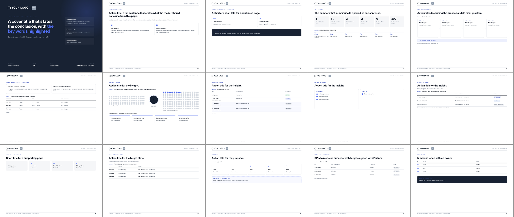

# Report template (A4 landscape)

HTML template for reports and documents meant for clients and partners: PoC reports, QBRs,
assessments, proposals in document form. A4 landscape, Inter font, cards, dark cover;
colours and logos come from the company brand in `assets/` (see "Brand").



> For **decks** (`.pptx` slides) the brand template in `../brand/` still applies. This template is
> for documents meant to be read, sent as PDF.

## Files

| File | What it is |
|------|--------|
| `report-template.html` | The template: a cover plus 14 sample pages, one per component. |
| `render.sh` | Builds the PDF with headless Chrome and PNG previews for checking. |
| `assets/brand.css` | The brand colours: the CSS variables the template uses. |
| `assets/logo-ink.png`, `assets/logo-white.png` | Company logo on a light background (headers) and on a dark background (cover). |
| `assets/partner-logo.png` | Placeholder for the client's or partner's logo. |
| `assets/report-preview.png` | Preview of the 15 pages (regenerate it after changing the brand). |

## How to use it

1. **Copy** the template and the assets into the deliverable's `_src/` folder, in the right zone
   (e.g. `company/clienti/{slug}/report/_src/`):
   ```bash
   mkdir -p company/clienti/acme/report/_src
   cp -R os/skills/presentations/report/assets os/skills/presentations/report/report-template.html company/clienti/acme/report/_src/
   mv company/clienti/acme/report/_src/report-template.html company/clienti/acme/report/_src/2026-11-05-acme-qbr.html
   ```
2. **Partner logo**: replace `assets/partner-logo.png` with the client's logo
   (square or horizontal, PNG). The box is 7 mm high in the header, 12.5 mm on the cover.
3. **Placeholders**: replace `{{COMPANY}}` (the company's short name,
   `config/company.yaml → company.short_name`), `{{PARTNER}}`, `{{TITLE}}` (header text,
   e.g. `QBR Q4`) and `{{DATE}}`.
4. **Pages**: pages 02–15 are a catalogue of components. Keep the ones you need,
   duplicate the `<section class="page">` sections and delete the rest. Renumber the footer (`.pg`)
   and the Exhibits.
5. **Render** (from the repo root):
   ```bash
   os/skills/presentations/report/render.sh company/clienti/acme/report/_src/2026-11-05-acme-qbr.html
   ```
   The PDF is written to the folder above `_src/`, with the same name. The script also prints
   the folder of the PNG previews.
6. **Check every page** on the previews. Pages have a fixed height: overflowing text is cut off
   with no error. If a page overflows, shorten it or split it onto a "· Continued" page.

## Components (sample page)

| Page | Component | When to use it |
|---|---|---|
| 01 | Dark cover with 3 side cards and a meta row | Always |
| 02 | Action title, lead, 2 numbered cards | Executive summary |
| 03 | 2 cards + dark "What we ask" box | End of the executive summary, next steps |
| 04 | 6 numbers + timeline | Numbers for the period, milestones |
| 05 | 4-step flow with a "loop" note | Current process |
| 06 | 2 context cards + comparison table | Segments, today / with us |
| 07 | Dot visual + 4 cards with a coloured border | A bottleneck and its consequences |
| 08 | Table with Yes / Partly / Not yet pills | Platform use, coverage |
| 09 | 2 cards with a check list | What works, feedback |
| 10 | Table with status pills (In progress / In design / Under evaluation) | Requests and roadmap |
| 11 | 4 numbered grey cards | Principles, way of working |
| 12 | Today / target table | Target process |
| 13 | 5 numbered steps + "to be completed" box | Proposal, parts waiting for input |
| 14 | KPI table | Metrics and targets |
| 15 | Numbered next steps + "What we ask" | Closing |

## Writing rules

- **Action title**: every page has a title that is a sentence with the conclusion, not a
  topic ("The new process halves response times", not "Results").
- **Kicker** above the title for the section (`Insight 2 · Use of the platform`); `· Continued`
  for pages that carry on.
- **Numbered exhibits** for tables and visuals, with the source below (`.source`).
- **One page, one message**: two light pages beat one full page.
- **No unvalidated dates or features** (rule 7 of CLAUDE.md): status pills describe
  the status, dates are confirmed by Product/CTO.
- **Language**: for foreign clients the document is in English; everything else follows
  `os/protocols/language.md`.

## Brand

The template contains no colours or logos: it reads them from `assets/`. To adapt it to your brand:

- **Colours**: in `assets/brand.css` change the variables' values, not their names. The most visible
  are `--accent` (kickers, numbers, card borders, highlighted words on the cover), `--accent-dk`
  (dark version of the accent, for small text), `--accent-soft` (pill backgrounds), `--navy`
  (cover and dark boxes), `--accent-glow` (the glow on the cover, the transparent accent) and
  `--ink` (titles). `--green` and `--blue` are used by the status pills.
- **Logos**: replace `assets/logo-ink.png` (on white, 5.6 mm high in the header) and
  `assets/logo-white.png` (on a dark background, 10 mm high on the cover). PNG with a transparent background.
- **Check**: run `render.sh` on the template again and look at the cover: the accent must stay
  readable on white (small text in `--accent-dk`) and on the dark blue of the cover.

## Requirements

- Google Chrome (or Chromium) for rendering.
- **Inter** font: loaded from Google Fonts; if installed locally, that copy is used (offline
  too). The "Inter Display" variant for titles is optional.
- `pdfinfo` / `pdftoppm` (poppler) for page checks and previews: optional.
